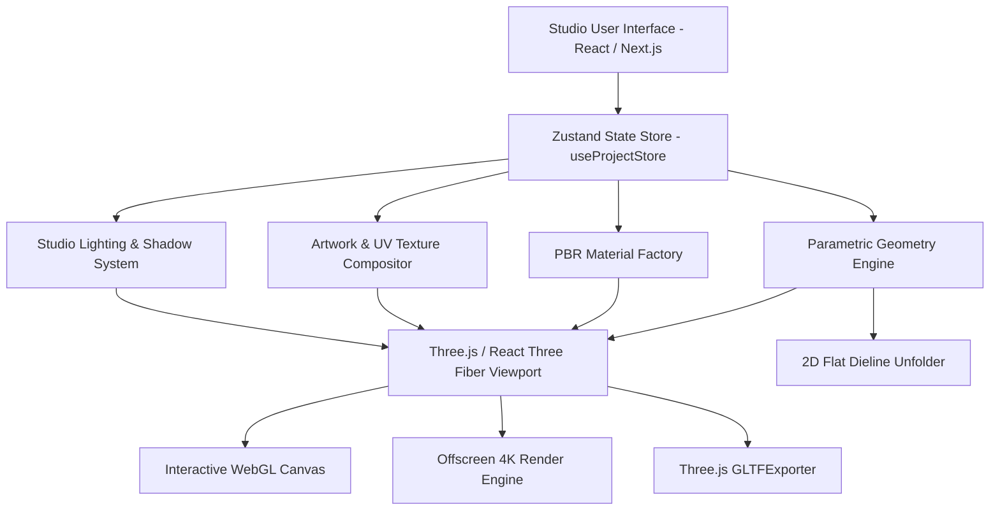

# FORMORA 3D — System Architecture & Engineering Specifications

This document details the architectural blueprints, data structures, rendering pipelines, and export workflows of **FORMORA 3D**.

---

## 1. High-Level Architecture

---

## 2. Core Modules & Responsibilities

### 2.1 State Management (`src/store/useProjectStore.ts`)
- Manages complete application state using **Zustand**.
- Maintains an undo/redo history stack (up to 30 snapshots) for all non-destructive parametric modifications.
- Handles multi-product hierarchy (`objects: PackagingObject[]`, `selectedObjectId`).
- Exposes immutable actions for geometry, dimensions, material parameters, artwork transforms, lighting rigs, and camera views.
- Supports full JSON project persistence and restoration.

### 2.2 Parametric Geometry Engine (`src/engine/geometry/`)
- Dynamically creates Three.js procedural geometries based on real physical packaging dimensions:
  - `BoxGeometryBuilder.ts`: Generates cuboid carton boxes with configurable corner fillets and optional top-opening flaps.
  - `BottleGeometryBuilder.ts`: Builds bottles via `THREE.CylinderGeometry` with customizable shoulder profiles (`rounded`, `sloped`, `flat`), bottle necks, and threaded caps.
  - `TubeGeometryBuilder.ts`: Combines cylindrical bodies with a pinched top crimp seal (`boxGeometry` taper) and a dispensing screw nozzle.
  - `PouchGeometryBuilder.ts`: Parametrically simulates flexible stand-up pouches (Doypack) with lower gusset curvature, side heat seals, and top ziplock seams.
  - `OvalBottleGeometryBuilder.ts`: Builds ergonomic cosmetic oval bottles using scaled elliptical profiles.

### 2.3 PBR Material Factory (`src/engine/materials/MaterialFactory.ts`)
- Configures `THREE.MeshPhysicalMaterial` shaders implementing physical optics:
  - **Matte Cardboard**: Roughness 0.85, Metalness 0.0, Clearcoat 0.0.
  - **Glossy Cardboard**: Roughness 0.25, Metalness 0.05, Clearcoat 0.6.
  - **Clear Glass**: Roughness 0.05, Transmission 0.95, IOR 1.52, Thickness 1.2.
  - **Amber Pharma Glass**: Transmissive amber absorption tint, Roughness 0.08, Transmission 0.92.
  - **Frosted Glass**: Roughness 0.45, Transmission 0.88, IOR 1.45.
  - **Glossy Plastic (HDPE/PET)**: Roughness 0.2, Metalness 0.02, Clearcoat 0.4.
  - **Brushed Aluminum**: Roughness 0.35, Metalness 0.9.
  - **Gold Foil Stamping**: Roughness 0.15, Metalness 0.95, Accent tone `#f59e0b`.
  - **Flexible Barrier Foil**: Roughness 0.3, Metalness 0.7.

### 2.4 Artwork & UV Compositing Pipeline (`src/engine/textures/ArtworkTextureManager.ts`)
- Uses offscreen HTML5 2D Canvas buffers to composite high-resolution user artwork onto UV texture maps.
- Supports 6 individual box faces (`front`, `back`, `left`, `right`, `top`, `bottom`) and 360° cylindrical wrap labels.
- Handles transform operations:
  - Aspect ratio preservation (`fit`, `fill`, `stretch`).
  - Sub-pixel horizontal & vertical offsets (`offsetX`, `offsetY`).
  - Free rotation (`0° - 360°`).
  - Bilateral mirroring (`flipH`, `flipV`).
  - Seamless tiling repetition (`repeatX`, `repeatY`).

### 2.5 Export Engine (`src/engine/export/`)
- **High-Resolution Still Renderer (`HighResRenderer.ts`)**:
  - Dynamically clones the live Three.js scene and active camera.
  - Allocates a dedicated `THREE.WebGLRenderer` configured with `preserveDrawingBuffer: true`, `alpha: true`, and `antialias: true`.
  - Renders offscreen at resolutions up to 3840×2160 (4K UHD) at standard 300 DPI print quality.
  - Encodes directly into PNG (with full alpha transparency), JPEG, or WebP data blobs.
- **GLB 3D Model Exporter (`GLTFExporterHelper.ts`)**:
  - Exports the current scene hierarchy, geometries, and baked PBR materials into standard binary `.glb` containers compatible with Blender, Unreal Engine, Unity, and web AR viewers.

---

## 3. Physical Units & Coordinate System

- **Internal 3D Coordinate Space**: Meters ($1.0\text{ unit} = 1.0\text{ meter}$).
- **User-Facing Units**:
  - Millimeters (`mm`): $1.0\text{ mm} = 0.001\text{ Three.js units}$.
  - Centimeters (`cm`): $1.0\text{ cm} = 0.01\text{ Three.js units}$.
  - Inches (`in`): $1.0\text{ in} = 0.0254\text{ Three.js units}$.
- **Ground Floor Plane**: $Y = 0$. Packaging objects are automatically pinned so their base rests directly on the floor.

---

## 4. Security & Isolation Guarantee

- All procedural and user artwork rendering happens entirely client-side via in-memory Canvas buffers.
- Zero network transmission of artwork images or proprietary packaging assets.
- Production builds produce static, self-contained bundles with zero external analytics tracking.
